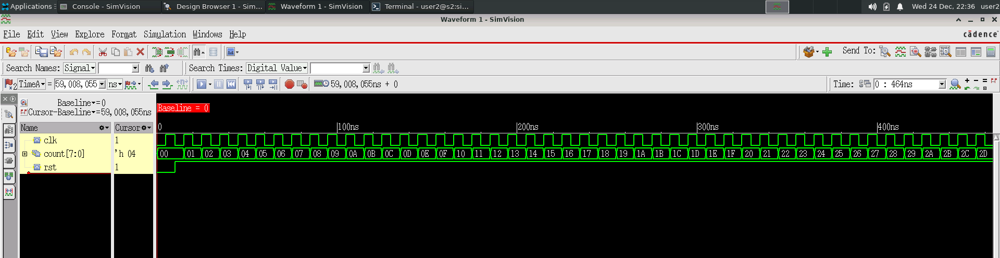
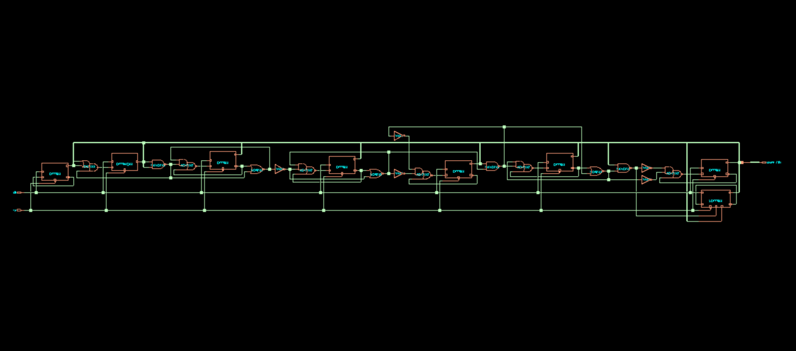
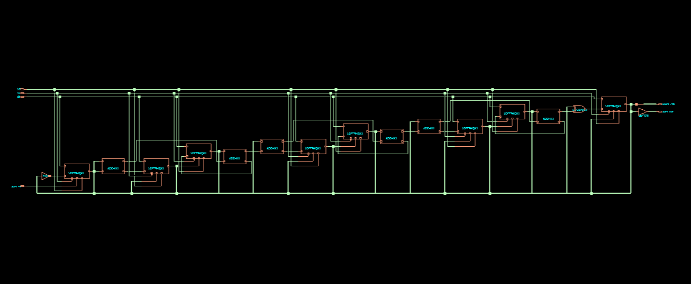
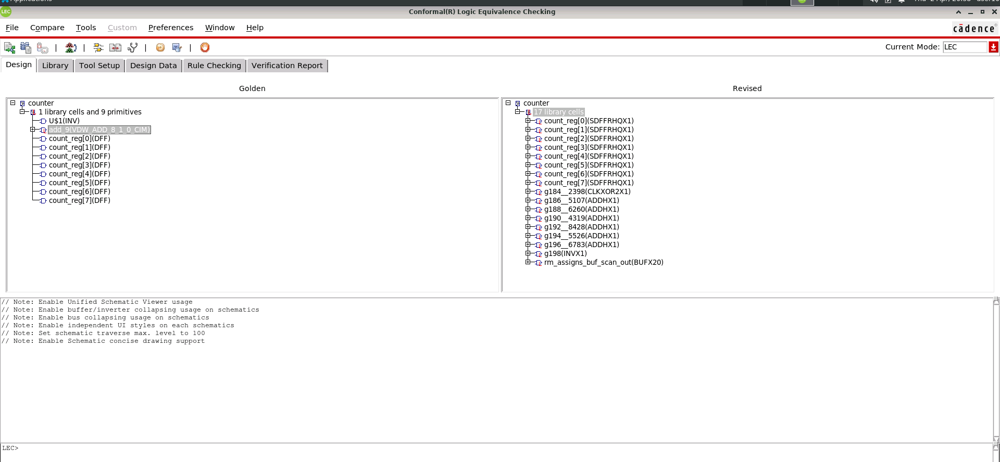

# 8-bit Simple Counter — RTL to GDSII

> **Technology:** GPDK 045 nm &nbsp;·&nbsp; **Tools:** Cadence Xcelium · Genus · Innovus · Conformal LEC &nbsp;·&nbsp; **PDK:** gsclib045

A full front-to-back ASIC implementation of a scan-enabled 8-bit synchronous counter — from RTL through functional simulation, logic synthesis, DFT insertion, formal equivalence checking, and place-and-route.

---

## Flow Overview

```
counter.v ──► Simulation ──► Synthesis ──► DFT ──► Equivalency Check ──► Physical Design
                (Xcelium)      (Genus)     (Genus)   (Conformal LEC)       (Innovus)
```

| Stage | Tool | Status |
|---|---|---|
| RTL & Simulation | Cadence Xcelium / SimVision | ✅ Done |
| Synthesis | Cadence Genus 23.13 | ✅ Done |
| DFT (Scan Insertion) | Cadence Genus 23.13 | ✅ Done |
| Equivalency Checking | Cadence Conformal LEC | ✅ Done |
| Physical Design (PnR) | Cadence Innovus | ✅ Done (hold-fix pending) |

---

<details>
<summary><strong>① RTL &amp; Functional Simulation</strong></summary>

<br>

### Design

A minimal 13-line Verilog module — an 8-bit synchronous counter with active-low asynchronous reset.

```verilog
module counter (clk, rst, count);
  input clk, rst;
  output reg [7:0] count;

  always @(posedge clk or negedge rst)
  begin
    if (!rst)
      count <= 0;
    else
      count <= count + 1;
  end
endmodule
```

### Testbench

```verilog
module counter_test;
  reg clk, rst;
  wire [7:0] count;

  initial begin
    clk = 0;
    rst = 0; #10;   // Assert reset for 10 ns
    rst = 1;        // Release — counter starts incrementing
  end

  counter counter1(clk, rst, count);
  always #5 clk = ~clk;  // 10 ns period clock
endmodule
```

### Simulation Waveform

Simulated using **Cadence Xcelium**, visualised in **SimVision**. The `count[7:0]` bus increments each clock cycle from `0x00` to `0x2D` (and beyond), confirming correct functional behaviour.



**Key observations:**
- Reset deasserts at t = 10 ns → counter starts from 0x00
- Increments correctly every rising `clk` edge
- No glitches or metastability observed

</details>

---

<details>
<summary><strong>② Logic Synthesis</strong></summary>

<br>

**Tool:** Cadence Genus Synthesis Solution 23.13-s073_1 &nbsp;·&nbsp; **Library:** `slow_vdd1v0_basicCells.lib` (slow/max corner)

### Script — `synthesis/genus_script.tcl`

```tcl
set_db init_lib_search_path <PDK_DIR>/lib/max
set_db init_hdl_search_path <counter_dir>

read_libs {slow.lib leon.lib}
read_physical -lef <PDK_DIR>/lef/gsclib045.fixed.lef

read_hdl -language v2001 counter.v
elaborate
read_sdc ../constraints/constraints_top.sdc

set_db syn_generic_effort medium
set_db syn_map_effort     medium
set_db syn_opt_effort     medium

syn_generic
check_timing_intent
check_design -unresolved
syn_map
syn_opt

report_timing > reports/report_timing.rpt
report_power  > reports/report_power.rpt
report_area   > reports/report_area.rpt
report_qor    > reports/report_qor.rpt

write_hdl > outputs/counter_netlist.v
write_sdc > outputs/counter_sdc.sdc
write_sdf -timescale ns -nonegchecks -recrem split \
          -edges check_edge -setuphold split > outputs/delays.sdf
```

### SDC Constraints — `constraints/constraints_top.sdc`

```tcl
create_clock -name clk -period 10 -waveform {0 5} [get_ports "clk"]
set_clock_transition -rise 0.1 [get_clocks "clk"]
set_clock_transition -fall 0.1 [get_clocks "clk"]
set_clock_uncertainty 0.1      [get_clocks "clk"]
set_input_delay  -max 1.0 [get_ports "rst"]      -clock [get_clocks "clk"]
set_output_delay -max 1.0 [get_ports "count[*]"] -clock [get_clocks "clk"]
```

### Synthesized Netlist — Schematic View



15 leaf cells: 8 × DFFRX2 (flip-flops) + 7 combinational gates (ADDHXL half-adders, INVX1). The ripple-carry increment chain is clearly visible.

### Synthesis Reports

**Area** (`report_area.rpt`)
```
Instance  Module  Cell-Count  Cell-Area  Net-Area  Total-Area
counter   NA            15     94.743    17.112     111.855
```

**Timing** (`report_timing.rpt`) — critical path: reg-to-reg through 6 half-adder carry stages
```
Path 1: MET (8101 ps) Setup Check  count_reg[0]/CK → count_reg[7]/SI
  Clock period : 10000 ps
  Data path    :  1716 ps
  Setup        :    83 ps
  Uncertainty  :   100 ps
  Slack        :  8101 ps  ✅
```

**Power** (`report_power.rpt`)
| Category | Leakage | Internal | Switching | Total | % |
|---|---|---|---|---|---|
| Register | 2.69e-9 W | 8.68e-6 W | 6.01e-7 W | 9.29e-6 W | 86.8% |
| Logic | 9.82e-10 W | 3.33e-7 W | 5.21e-7 W | 8.55e-7 W | 8.0% |
| Clock | — | — | 5.60e-7 W | 5.60e-7 W | 5.2% |
| **Total** | **3.67e-9 W** | **9.02e-6 W** | **1.68e-6 W** | **10.7 µW** | |

**QoR Summary**
```
Clock  Period     WNS      TNS   Violating
clk    10000 ps  8101 ps  0.0       0

Leaf instances       : 15
Sequential           : 8
Combinational        : 7
Cell area            : 94.743 µm²
Max fanout (clk)     : 8
Runtime              : ~46 s
```

</details>

---

<details>
<summary><strong>③ Design for Test (DFT) — Scan Insertion</strong></summary>

<br>

**Tool:** Cadence Genus 23.13 &nbsp;·&nbsp; **Scan style:** Muxed-scan &nbsp;·&nbsp; **Library:** `slow_vdd1v0_basicCells.lib`

### Architecture

| Parameter | Value |
|---|---|
| Scan style | Muxed-scan (`muxed_scan`) |
| Number of chains | 1 (`top_chain`) |
| Chain length | 8 flip-flops |
| Scan-in port | `scan_in` |
| Scan-out port | `scan_out` |
| Shift enable | `SE` (active-high, new port) |
| Scan FF cell | `SDFFRHQX1` (async reset, scan-enabled) |
| Scan-out buffer | `BUFX20` (to replace assign statement) |

All 8 `count_reg[0:7]` are stitched LSB → MSB into a single rising-edge scan chain.

### Script — `dft/genus_dft_script.tcl`

```tcl
set PDK_DIR "/home/server2/design_kits/cadence_dft/Stylus_21.1x_RAK/libs/GPDK045"
set_db init_lib_search_path $PDK_DIR/gsclib045/timing
read_libs slow_vdd1v0_basicCells.lib
read_physical -lef "$PDK_DIR/gsclib045_tech/lef/gsclib045_tech.lef \
                    $PDK_DIR/gsclib045/lef/gsclib045_macro.lef"

read_hdl -language v2001 counter.v
elaborate
read_sdc ../constraints/constraints_top.sdc

# DFT pre-synthesis setup
set_db dft_scan_style muxed_scan
set_db dft_prefix dft_
define_test_signal -function shift_enable -name SE -active high -create_port SE
check_dft_rules

syn_generic && syn_map && syn_opt

# Scan chain definition and stitching
check_dft_rules
set_db design:counter .dft_min_number_of_scan_chains 1
define_dft scan_chain -name top_chain -sdi scan_in -sdo scan_out -create_ports

set_db remove_assigns true
add_assign_buffer_options -ports scan_out -buffer_or_inverter BUFX20

connect_scan_chains -auto_create_chains
syn_opt

report_scan_chains > reports/report_dft_chains.rpt

write_hdl       > outputs/counter_netlist_dft.v
write_sdc       > outputs/counter_sdc_dft.sdc
write_sdf ...   > outputs/delays.sdf
write_scandef   > outputs/counter_scanDEF.scandef
```

### Outputs

**Scan-enabled port interface** (`counter_netlist_dft.v`):
```verilog
module counter(clk, rst, count, SE, scan_in, scan_out);
```

**ScanDEF** (`outputs/counter_scanDEF.scandef`) — consumed directly by Innovus PnR:
```
SCANCHAINS 1;
  -top_chain_seg1_clk_rising
    + PARTITION p_clk_rising  MAXBITS 8
    + START PIN scan_in
    + FLOATING
      count_reg[0] ( IN SI ) ( OUT 0 )
      ...
      count_reg[7] ( IN SI ) ( OUT 0 )
    + STOP PIN scan_out
END SCANCHAINS
```

### Post-DFT Schematic

`DFFRX2` cells have been replaced with `SDFFRHQX1` scan flip-flops. The `SE` mux and scan chain wiring is visible alongside the functional increment carry chain.



</details>

---

<details>
<summary><strong>④ Formal Equivalency Checking</strong></summary>

<br>

**Tool:** Cadence Conformal LEC &nbsp;·&nbsp; **Mode:** LEC (Logic Equivalence Checking)

### Verification Setup

| Parameter | Value |
|---|---|
| Golden | `counter.v` (original RTL) |
| Revised | `dft/outputs/counter_netlist_dft.v` (scan-inserted gate-level) |
| Library | `slow_vdd1v0_basicCells.lib` (`-liberty`) |
| SE constraint | Tied to `0` on Revised (functional mode, scan disabled) |
| Ignored inputs | `scan_in` (Revised-only port) |
| Ignored outputs | `scan_out` (Revised-only port) |

### Script — `Equivalency_Checking/counter_after_dft.do`

```tcl
set log file counter_lec.log -replace

read library <PDK_DIR>/gsclib045/timing/slow_vdd1v0_basicCells.lib -liberty -both

read design ../counter.v                         -verilog -golden
read design <NETLIST>/counter_netlist_dft.v      -verilog -revised

add pin constraints 0 SE      -revised
add ignored inputs  scan_in   -revised
add ignored outputs scan_out  -revised

set system mode lec
add compared points -all
compare
```

### Results

| Key Points | Compared | Equivalent | Non-Equivalent |
|---|---|---|---|
| Primary Outputs (PO) | 8 | 8 | 0 |
| Flip-Flops (DFF) | 8 | 8 | 0 |
| **Total** | **16** | **16** | **0** |

**✅ Result: PASS — All 16 key points EQUIVALENT**

### Conformal LEC GUI

Golden (RTL) vs. Revised (scan netlist) side-by-side. The Revised design shows the 17 library cells mapped to `SDFFRHQX1` scan flip-flops + `ADDHX1` carry chain + `BUFX20` scan-out buffer.



</details>

---

<details>
<summary><strong>⑤ Physical Design — Place &amp; Route</strong></summary>

<br>

**Tool:** Cadence Innovus Implementation System &nbsp;·&nbsp; **PDK:** GPDK045 (gsclib045) &nbsp;·&nbsp; **Supply:** 1.0 V

### Input Files

| File | Purpose |
|---|---|
| `dft/outputs/counter_netlist_dft.v` | Gate-level netlist (scan-enabled) |
| `PhysicalDesign/Implementation/counter.view` | MMMC view definition |
| `PhysicalDesign/Implementation/counter_sdc.sdc` | PD timing constraints |
| `PhysicalDesign/Implementation/counter.scandef` | Scan chain definition |
| `PhysicalDesign/Implementation/pins.io` | Pin placement |
| `PhysicalDesign/Implementation/power.tcl` | Global net connections |

---

<details>
<summary>&nbsp;&nbsp;&nbsp;&nbsp;<strong>⑤·A — Design Import &amp; MMMC</strong></summary>

<br>

The MMMC view (`counter.view`) defines two analysis corners — worst-case (setup) and best-case (hold) — both using the same GPDK045 RC extraction corner.

```tcl
create_library_set -name max_timing -timing ../lib/slow_vdd1v0_basicCells.lib
create_library_set -name min_timing -timing ../lib/fast_vdd1v0_basicCells.lib

create_rc_corner -name rccorners \
  -cap_table ../captable/cln28hpl_1p10m+alrdl_5x2yu2yz_typical.capTbl \
  -qrc_tech   ../QRC_Tech/gpdk045.tch \
  -pre_route_res 1 -post_route_res 1 \
  -pre_route_cap 1 -post_route_cap 1 -post_route_cross_cap 1

create_analysis_view -name wc -constraint_mode sdc_cons -delay_corner max_delay
create_analysis_view -name bc -constraint_mode sdc_cons -delay_corner min_delay
set_analysis -setup wc -hold bc
```


</details>

<details>
<summary>&nbsp;&nbsp;&nbsp;&nbsp;<strong>⑤·B — Floorplan &amp; Pin Placement</strong></summary>

<br>

Core rows are initialized with a fixed core-to-die margin. Pins are placed on all four sides using `read_io_file pins.io`.

**Pin distribution (`pins.io`):**
```
Top:    clk, rst, count[7], count[6]          (Metal-2)
Left:   count[5], count[4], count[3], count[2] (Metal-3)
Bottom: count[1], count[0], SE, scan_in        (Metal-2)
Right:  scan_out                               (Metal-3)
```


</details>

<details>
<summary>&nbsp;&nbsp;&nbsp;&nbsp;<strong>⑤·C — Power Planning</strong></summary>

<br>

Three-stage power plan: rings → vertical stripes → follow-pin special route.

**Global net connections (`power.tcl`):**
```tcl
connect_global_net VDD -type pg_pin -pin VDD -inst *
connect_global_net VSS -type pg_pin -pin VSS -inst *
connect_global_net VDD -type tie_hi
connect_global_net VSS -type tie_lo
connect_global_net VDD -type tie_hi -pin VDD -inst *
connect_global_net VSS -type tie_lo -pin VSS -inst *
```


**Ring configuration:** Metal-10 (V) + Metal-11 (H), width = 0.7 µm, spacing = 0.2 µm, offset = 0.5 µm.


</details>

<details>
<summary>&nbsp;&nbsp;&nbsp;&nbsp;<strong>⑤·D — Placement</strong></summary>

<br>

`place_design` runs global → legalization → detailed placement. All 8 scan flip-flops (`count_reg[0:7]`) and 9 combinational cells are placed within the core rows. VDD/VSS rails are clearly visible as horizontal blue lines.


</details>

<details>
<summary>&nbsp;&nbsp;&nbsp;&nbsp;<strong>⑤·E — Clock Tree Synthesis</strong></summary>

<br>

`ccopt_design` builds and optimizes the clock tree for `clk`. Reset (`rst`) and scan enable (`SE`) are kept ideal throughout PD — declared via `set_ideal_network` in the SDC, so CTS does not insert buffers for them.

**SDC clock constraints used in PD:**
```tcl
create_clock "clk" -add -period 10.0 -waveform {0.0 5.0} [get_ports clk]
set_clock_transition 0.1 [get_clocks clk]
set_clock_uncertainty -setup 0.1 [get_ports clk]
set_clock_uncertainty -hold  0.1 [get_ports clk]
set_ideal_network [get_ports rst]
set_ideal_network [get_ports SE]
set_dont_use [get_lib_cells slow_vdd1v0/HOLDX1]
```

</details>

<details>
<summary>&nbsp;&nbsp;&nbsp;&nbsp;<strong>⑤·F — Routing (NanoRoute)</strong></summary>

<br>

Detailed signal and clock routing performed with NanoRoute. Post-route DRC and connectivity checks both pass clean.


</details>

<details>
<summary>&nbsp;&nbsp;&nbsp;&nbsp;<strong>⑤·G — Filler Cell Insertion</strong></summary>

<br>

Filler cells (FILL / DECAP) inserted to close n-well gaps between standard cells and complete the physical implementation.


> Animated summary of the full PnR journey:


</details>

<details>
<summary>&nbsp;&nbsp;&nbsp;&nbsp;<strong>⑤·H — Timing Signoff</strong></summary>

<br>

Post-route RC extraction (`extract_rc`) followed by `time_design` on both setup (WC) and hold (BC) views.

#### Setup — Worst-Case Corner ✅

```
Setup views included: wc

Setup mode   │  all   │ reg2reg │ default
─────────────────────────────────────────
WNS (ns):    │  8.341 │  8.341  │  8.731
TNS (ns):    │  0.000 │  0.000  │  0.000
Violating:   │  0     │  0      │  0
All Paths:   │  40    │  15     │  25
```

**Zero setup violations. WNS = 8.341 ns (83% slack on a 10 ns clock).**


#### Hold — Best-Case Corner ⚠️

```
Hold views included: bc

Hold mode    │  all    │ reg2reg │ default
──────────────────────────────────────────
WNS (ns):    │ -0.093  │ -0.024  │ -0.093
TNS (ns):    │ -0.988  │ -0.161  │ -0.827
Violating:   │  17     │  8      │  9
All Paths:   │  24     │  15     │  9

Density: 69.949%
```

**17 hold violations, WNS = −93 ps.** A dedicated `time_design -hold` pass with hold-fix buffering will resolve these. In-progress — to be updated.


</details>

<details>
<summary>&nbsp;&nbsp;&nbsp;&nbsp;<strong>⑤·I — Power Integrity (Rail Analysis)</strong></summary>

<br>

Rail analysis run in Voltus (integrated within Innovus). IR-drop map confirms worst-case droop < **10 mV** against a 1.0 V supply — well within the 5% limit (50 mV).


</details>

</details>

---

## Results Summary

| Stage | Metric | Result |
|---|---|---|
| Simulation | Functional correctness | ✅ Pass |
| Synthesis — WNS | 8101 ps (setup) | ✅ 0 violations |
| Synthesis — Area | 94.7 µm² cell + 17.1 µm² net | ✅ |
| Synthesis — Power | 10.7 µW total | ✅ |
| DFT | Scan chain | 1 chain × 8 FFs |
| LEC | 16/16 key points equivalent | ✅ Pass |
| PnR — Setup | WNS = +8.341 ns | ✅ 0 violations |
| PnR — Hold | WNS = −0.093 ns | ⚠️ 17 violations (fix in progress) |
| PnR — IR Drop | < 10 mV | ✅ Pass |
| PnR — Density | 69.95% | ✅ |

---

*Part of the [PhysicalDesign-SignoffSaga](../..) RTL-to-GDSII project series.*
