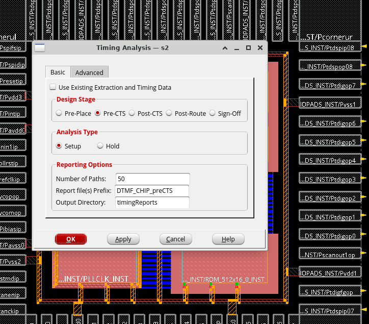
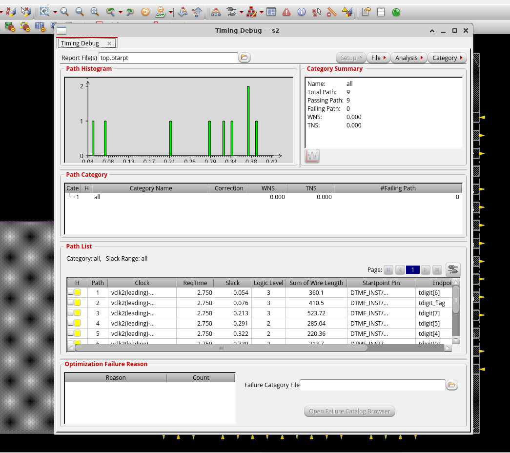
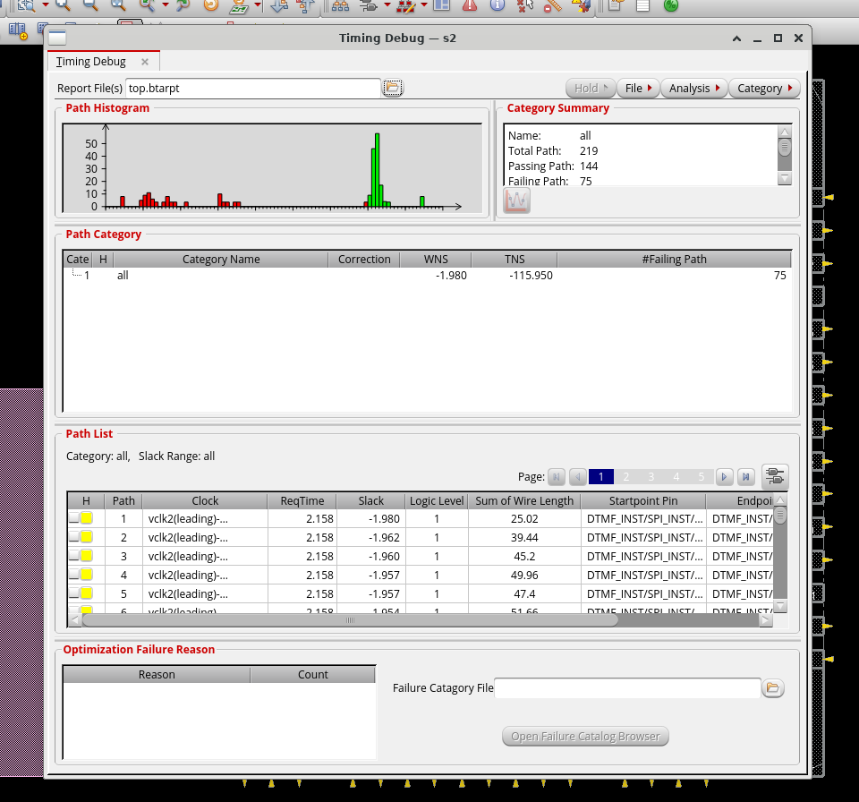
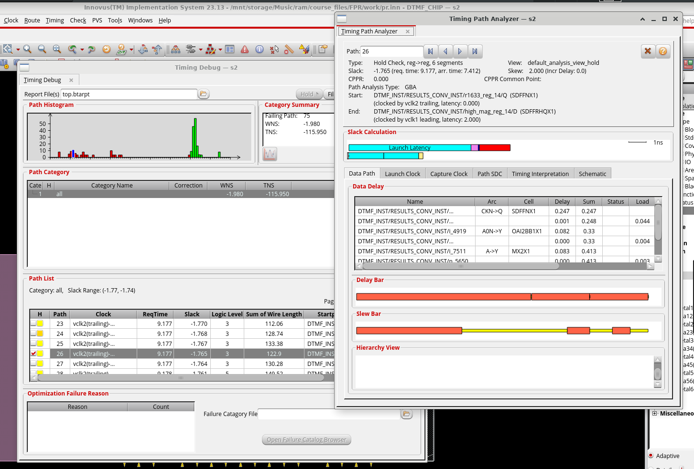

# Parasitic Extraction and Pre-CTS Timing Analysis in Innovus

Pre-CTS timing flow on the DTMF design using Cadence Innovus: extract RC, generate setup and hold reports, and debug failing paths.

## Flow

1. Restore the placed and globally routed design.
2. Extract RC parasitics.
3. Write an SDF with ideal clocks.
4. Run setup and hold timing analysis.
5. Debug failing paths.
6. Save the checkpoint.

## 1. Restore the Design

```bash
cd work
innovus -stylus
```

**File → Restore Design** → `../saved/pr.inn`

## 2. Extract RC

**Timing → Extract RC** → **OK**

The design status changes to **RC Extracted**. The RC data stays annotated in the design database and is not saved to disk.

## 3. Calculate Delays

The clock is ideal because CTS has not been run yet.

```tcl
write_sdf dtmf.sdf -ideal_clock_network
```

## 4. Timing Analysis

### Setup

**Timing → Report Timing** with these settings:

| Option | Value |
|---|---|
| Design Stage | Pre-CTS |
| Analysis Type | Setup |
| Number of Paths | 50 |
| Report Prefix | `DTMF_CHIP_preCTS` |
| Output Directory | `timingReports` |



**Timing → Debug Timing** opens the setup report.



### Hold

```tcl
time_design -pre_cts -hold
```

In **Timing → Debug Timing**, select **Generate**, set **Check Type** to `hold`, and click **OK**.



## 5. Debug Failing Paths

Select the failing paths in the Path List to highlight them in the physical view, then double-click a path to open the Timing Path Analyzer.



## 6. Save

**File → Save Design** → `preCTSopt.inn` (save from the `work` directory).

## Tools

Cadence Innovus (Stylus Common UI)
